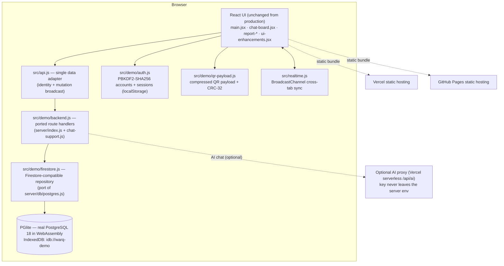

# WarQ — live judge demo

WarQ turns any physical product into a verifiable digital warranty. A shop issues
a QR sticker per product, records the sale in seconds, and the customer opens the
warranty page by scanning — no app and no account required.

This repository is a **static, zero-cost, judge-ready demo** of the production
WarQ application. It keeps the real product's concept, UI, flows, database schema
and feature set, but replaces the Express + PostgreSQL + Firebase backend with
code that runs entirely in the browser. There is no server to start, no paid
service and no real customer data.

> Everything is honest: what is real, what is simulated and what could not be
> replicated is documented in [`DEMO_MAPPING.md`](./DEMO_MAPPING.md) and inside the
> app under **Judge guide → Production vs Demo**.

---

## Live demo

| Target | URL |
| --- | --- |
| Vercel (primary) | _filled in after deployment_ |
| GitHub Pages (mirror) | _filled in after deployment_ |

Both targets are built from the same codebase. The only difference is the base
path (`/` on Vercel, `/warq-demo/` on GitHub Pages), selected by the
`VITE_BASE_PATH` environment variable.

---

## Architecture



### How the data layer works

1. `src/api.js` is the only place the UI talks to. It resolves the signed-in
   identity and forwards each call to `src/demo/backend.js`.
2. `handleApi()` implements the production endpoints (same names, same payloads,
   same error codes) against `src/demo/firestore.js`.
3. The repository is the original server's Firestore-compatible shim, so the
   ported route handlers barely changed.
4. The database is **PGlite** — PostgreSQL 18 compiled to WebAssembly — running
   the **same DDL** as production, persisted to IndexedDB. Reloading the page
   keeps your data. **Reset demo data** rebuilds the seed.
5. Each printed QR embeds a deflate-compressed warranty payload plus a CRC-32
   checksum, so the public page renders even with no database at all.

---

## Demo credentials

All seeded accounts are verified and ready to use. Password is the same unless
noted.

| Role | Sign in with | Password |
| --- | --- | --- |
| Administrator | Admin ID `warq-admin` (email `admin@warq.demo`) | `admin1234` |
| Shopkeeper — Rahman Electronics (Dhaka) | `rahman@warq.demo` | `warq1234` |
| Shopkeeper — Chattogram Mobile Zone | `ctg@warq.demo` | `warq1234` |
| Shopkeeper — Sylhet Home Appliance (no access) | `sylhet@warq.demo` | `warq1234` |
| Customer — Nusrat Jahan | `nusrat@warq.demo` | `warq1234` |
| Customer — Tanvir Ahmed | `tanvir@warq.demo` | `warq1234` |

The sign-in screen and the Judge guide both show these credentials. You can also
switch between any role from the floating **Judge guide** without signing out.

Seeded data: 3 shops, 6 accounts, 15+ customers, 56 QR codes (40 sold across
active / expired / no-warranty / voided states), warranty claims, chat history,
notifications, payments and audit logs.

---

## 3-minute judge walkthrough

1. **Open the app.** The first screen explains WarQ in two lines. Click
   **Start demo as a shopkeeper**. The floating **Judge guide** (bottom-right)
   ticks off steps as you go.
2. **Requests → create a QR warranty.** Add a product, customer and warranty
   duration, then generate the QR folder. Open it to see the QR image and
   printable warranty card.
3. **Open the public warranty page.** Scan the code from the app or open
   `#/scan/<CODE>`. The page needs no account and shows the live countdown. It
   also works from the embedded QR payload with no database.
4. **Submit a claim.** On the public page click **Raise a warranty claim**; or
   switch to a **Customer** in the Judge guide and use the customer portal's
   **Scan & claim** tab.
5. **Review the claim as the shop.** Switch to **Administrator** → **Claims**
   tab and approve / reject / resolve it. Switch back to the customer to see the
   updated timeline.
6. **Try the Chat Board.** Ask the assistant a warranty question, then open
   **Chat with Admin**. Open a second tab to see cross-tab realtime sync.
7. **Run a sandbox payment.** Subscription tab → pick a plan → pay with a test
   card. The checkout is labelled **“Sandbox — no real payment”**.
8. **Check the admin console** — users, orders, pricing, claims, support queue
   and platform analytics. Finish with **Production vs Demo** in the Judge guide.

---

## Local run

Requires Node 20+ and npm.

```powershell
npm install
npm run dev
```

Open http://localhost:5173. To validate the database schema and seed without a
browser:

```powershell
npm run db:schema:check
node scripts/check-seed.mjs
node scripts/check-api.mjs
```

Production build and preview:

```powershell
npm run build
npm run preview
```

End-to-end smoke tests (Playwright, desktop + 375px):

```powershell
npm run test:smoke:install
npm run test:smoke
```

---

## Deployment

### Vercel (primary)

```powershell
npm install -g vercel
vercel link
vercel env add VITE_AI_PROXY_URL production
vercel --prod
```

`vercel.json` already sets the framework, build command, output directory and
the `/scan/:code` + `/app/:path*` rewrites so deep links refresh correctly.
The optional AI proxy lives in `api/ai.js` (Vercel serverless function, routed at
`/api/ai`). It reads a single free-tier key from the Vercel environment and the
key never reaches the browser:

- `GEMINI_API_KEY` (Google AI Studio, free tier) — preferred, or
- `GROQ_API_KEY` (Groq free tier), or
- `OPENROUTER_API_KEY` (OpenRouter free models).
- `AI_MODEL` — optional model override (e.g. `gemini-2.0-flash`).

Set the key with `vercel env add GEMINI_API_KEY production` and redeploy. Without
a key the function returns `503` and the assistant falls back to a deterministic
local reply, and the UI says so. With no key configured, no serverless function
is required at all.

> The GitHub Pages mirror has no serverless runtime, so it always uses the
> offline assistant. Everything else — including the QR payload, claims,
> sandbox payments and exports — is fully functional there.

### GitHub Pages (mirror)

```powershell
git init
git add .
git commit -m "WarQ demo"
gh repo create null0xlab/warq-demo --public --source=. --push
```

Then in **Settings → Pages** choose **GitHub Actions**. The workflow in
`.github/workflows/deploy.yml` builds with `VITE_BASE_PATH=/warq-demo/`, which is
the only change needed for the mirror. `public/404.html` redirects deep links
such as `/warq-demo/scan/<CODE>` back into the hash router.

---

## Honest limitations

- **Email and SMS are not sent.** Verification and reset codes are generated
  locally and shown on screen, clearly labelled as demo-only.
- **Payments are not real.** The bKash/Nagad checkout is a sandbox simulator with
  test cards and a permanent “no real payment” banner.
- **Data is per-browser.** Records live in IndexedDB on your device; there is no
  shared backend, so two different devices do not see the same data. Cross-tab
  sync uses a `BroadcastChannel` and works within one browser.
- **The warranty claim / customer role is an extension.** It is not part of the
  original production product; it was added so the demo can show the full
  customer journey end to end, and it is disclosed as such.
- **AI replies depend on configuration.** With a proxy key the assistant uses the
  real model; without one it answers from a deterministic local rule set.
- **No linter or type checker.** The production WarQ codebase has none either;
  the gates are the Vite production build and the Playwright smoke suite.
- **This demo never writes to the production WarQ codebase.** The original
  project at `E:\WarQ` is untouched.
